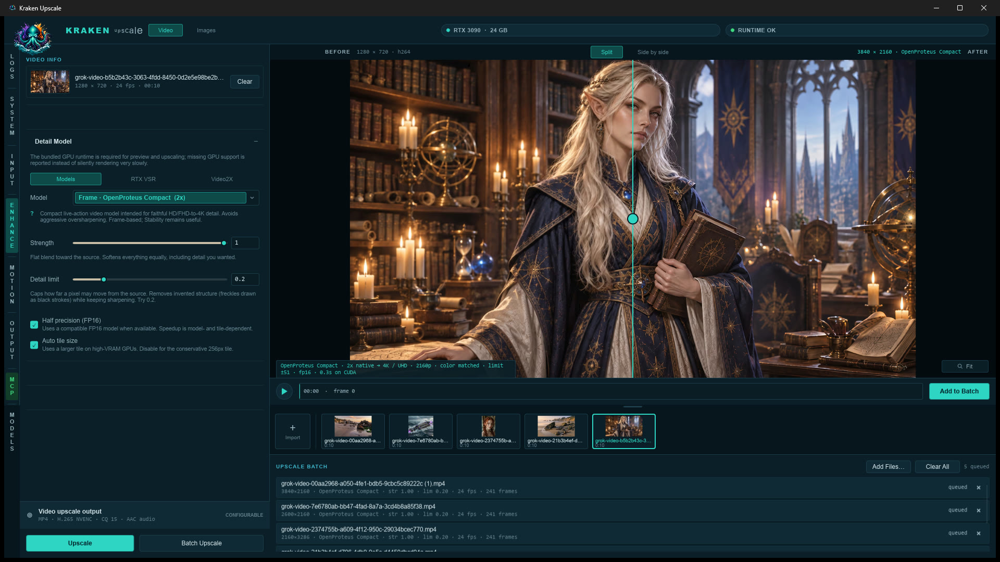
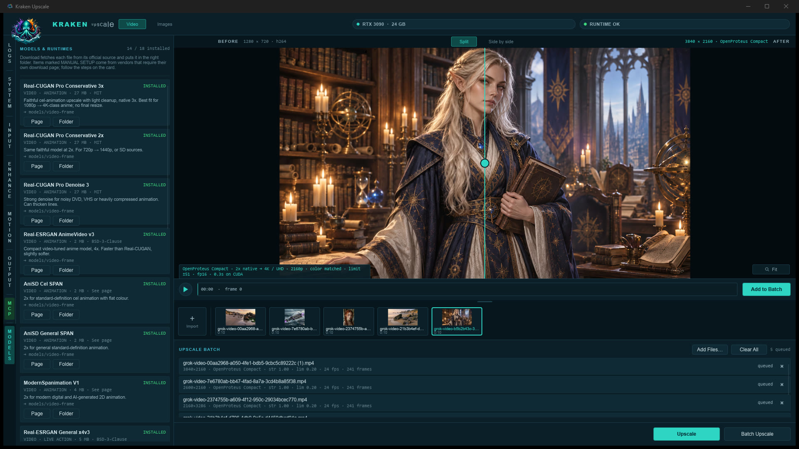
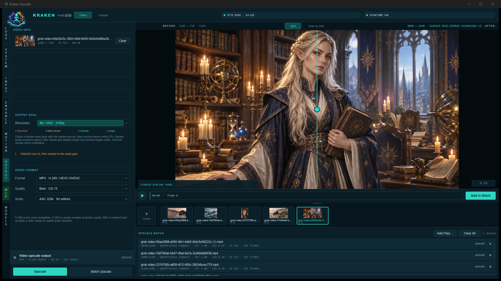

# Kraken Upscale

Native Windows AI upscaler for video and still images. Rust + Slint UI, ONNX
Runtime on NVIDIA CUDA, NVIDIA RTX Video Super Resolution, Video2X
(Real-ESRGAN / Real-CUGAN / Anime4K), RIFE frame interpolation, and optional
FLUX generative refine — with a built-in model downloader so you never have to
hunt for weights or folders.

[Watch the demo on YouTube](https://youtu.be/nv3yAlPCmAo) ·
[Download the latest release](https://github.com/krakenunbound/kraken-upscale/releases/latest)



| | |
|---|---|
|  |  |
| **Models tab** — install status and one-click download for every supported model and runtime | **Video2X pipeline** — Real-ESRGAN, Real-CUGAN and Anime4K presets beside ONNX models and RTX VSR |
|  |  |
| **Output** — named goals or ×2/×3/×4, NVENC H.264/H.265, AAC audio for editors | **System** — live GPU stats, runtime versions, Release GPU Memory |

## What it does

- **Three video pipelines**
  - **Models** — ONNX on CUDA with feathered tiling: Real-CUGAN, Real-ESRGAN,
    AniSD, OpenProteus, ModernSpanimation, and true multi-frame NanoVSR
  - **RTX VSR** — NVIDIA's persistent video session with temporal history,
    rendered at the exact output size
  - **Video2X** — Real-ESRGAN, Real-CUGAN (SE/Pro, every denoise level) and
    Anime4K through the Video2X runtime
- **Models tab** — every supported model and runtime with install status,
  size, licence and destination; **Download** puts it in the right folder
- **Source profiles**, including **anime** presets (remaster / Blu-ray,
  DVD / TV broadcast with inverse telecine, modern digital) that pick the best
  installed anime model for you
- **Batch workflow** — drop many files at once or use **Add Files…**; files
  are sorted naturally and queued with the current settings. A clip strip
  shows thumbnails and lengths; remove single items or **Clear All**
- Split or side-by-side before/after preview with zoom and pan
- Named output goals (720p through 4K) or ×2 / ×3 / ×4, plus an optional
  16:9 crop applied before the upscale
- RIFE interpolation to 48 / 60 / 120 fps; temporal lock against shimmer
- NVENC H.264 / H.265 to MP4 or MKV; copy audio, drop it, or re-encode to
  **AAC 320k** for editors such as Premiere
- Still images: PNG / JPEG / WebP, RTX VSR, and FLUX Generative Refine
- MCP control server so AI agents can drive the visible app (`MCP/`)

Output is written **next to the source file** with a unique name.

## Quick start

1. Download `Kraken.Upscale.exe` from the
   [latest release](https://github.com/krakenunbound/kraken-upscale/releases/latest)
   (or build it, below) and put it in its own folder.
2. Put FFmpeg (`ffmpeg.exe`, `ffprobe.exe` and DLLs) in an `ffmpeg\` folder
   beside it, and the CUDA / cuDNN runtime DLLs beside it or in `cuda\`.
3. Start Kraken, open the **MODELS** tab on the left rail and click
   **Download** on the models you want, then **Restart Kraken**.
4. Drop a video, pick a Content profile and output goal, then **Upscale** or
   **Add to Batch**.

### Which pipeline?

| Source | Suggested setup | Notes |
|---|---|---|
| HD anime / Blu-ray remaster | Content **Anime — remaster**, Models · Real-CUGAN Pro Conservative 3x | Faithful line art, seam-free tiling |
| DVD / broadcast anime | Content **Anime — DVD / TV** | Inverse telecine + deblock, AniSD Cel SPAN |
| AI or live-action video | Models · OpenProteus or Real-ESRGAN General, Stability on | |
| Need it fast | RTX VSR, or Video2X · Anime4K | Anime4K is a sharpening shader, not a GAN |

Measured on an RTX 3090, 1440×1080 → 4320×3240 (3×): Anime4K ≈ 52 fps,
RTX VSR Ultra ≈ 9 fps, Video2X AnimeVideo v3 ≈ 6 fps, Real-CUGAN Pro ≈ 3 fps.
Smaller goals run proportionally faster.

## Requirements

- Windows 10/11, 64-bit
- NVIDIA GPU with a current Game Ready or Studio driver
- [FFmpeg](https://ffmpeg.org/download.html) (`ffmpeg` and `ffprobe`) on `PATH`,
  or in an `ffmpeg\` folder beside the executable
- CUDA-capable [ONNX Runtime](https://onnxruntime.ai/) (the `ort` crate pulls
  it; extra CUDA provider DLLs can sit next to the exe)
- Optional: RTX GPU + driver 570.65+ for RTX VSR; Vulkan for Video2X
- [Rust](https://rustup.rs/) 1.92+ (MSVC toolchain) only to build from source

## Build

```bat
cargo build --release
```

Run `target\release\kraken-upscale.exe`. A portable copy can be named
`Kraken Upscale.exe` beside `ffmpeg\`, `models\`, and (if you use them)
`cuda\`, `rtx-vsr\`, `video2x\`, and `native-diffusion\`.

## Models

The easiest route is the **MODELS** tab on the left rail: each card shows
whether the model is installed and downloads it into the correct folder for
you. The tables below are the same catalog for manual installs.

Kraken does not ship weights. Drop ordinary `.onnx` or RRDBNet `.pth` files
into the folders below (next to the exe, or in this repo while developing).
The app scans those folders on startup.

| Folder | What goes here |
|---|---|
| `models/` | Still-image ESRGAN-family models (`.onnx` or `.pth`) |
| `models/video-frame/` | Fast single-frame video / animation models |
| `models/video/` | Multi-frame video models (NanoVSR) |
| `models/interpolation/` | RIFE timestep graph |
| `models/generative/` | FLUX package JSON + weight files |

Optional `models.json` files add nicer names and scale metadata. If a file is
missing from JSON, Kraken still discovers it from the filename.

### Video-frame models (recommended first)

Download the ONNX files and put them in `models/video-frame/`:

| Model | Scale | Best for | Download |
|---|---|---|---|
| Real-ESRGAN General x4v3 | 4× | General / AI video | [Hugging Face](https://huggingface.co/CoderViking/realesr-general-x4v3-onnx) · [Real-ESRGAN](https://github.com/xinntao/Real-ESRGAN/releases) |
| Real-ESRGAN AnimeVideo v3 | 4× | Animation | [vs-mlrt release](https://github.com/AmusementClub/vs-mlrt/releases/tag/model-20211209) · [docs](https://github.com/xinntao/Real-ESRGAN/blob/master/docs/anime_video_model.md) |
| Real-CUGAN Pro Conservative 3x | 3× | HD anime → 4K-class, no final resize | [vs-mlrt](https://github.com/AmusementClub/vs-mlrt/releases/tag/model-20211209) (`cugan-pro_v3.7z` → `pro-conservative-up3x.onnx`) |
| Real-CUGAN Pro Conservative | 2× | 2D, light cleanup | [vs-mlrt](https://github.com/AmusementClub/vs-mlrt/releases/tag/model-20211209) · [Real-CUGAN](https://github.com/bilibili/ailab/tree/main/Real-CUGAN) |
| Real-CUGAN Pro Denoise 3 | 2× | 2D, stronger denoise | same vs-mlrt release |
| AniSD General SPAN | 2× | SD animation | [Sirosky AniSD](https://github.com/Sirosky/Upscale-Hub/releases/tag/AniSD) (`2x_AniSD_G6i1_SPAN_215K_fp32.onnx`) |
| AniSD Cel SPAN | 2× | Cel / flat color | same AniSD release (`2x_AniSD_AC_G6i2b_SPAN_190K_fp32.onnx`) |
| OpenProteus Compact | 2× | Live-action HD | [Sirosky OpenProteus](https://github.com/Sirosky/Upscale-Hub/releases/tag/OpenProteus) |
| ModernSpanimation V1 | 2× | Modern 2D / generated animation | [TNTwise](https://github.com/TNTwise/Models/releases/tag/2x_ModernSpanimationV1) |

SHA-256 hashes of the exact files Kraken was tested with are in
[`models/video-frame/SOURCES.md`](models/video-frame/SOURCES.md).

These graphs still run **one frame at a time**. Turn on **Stability** if you
want the temporal lock. True neighboring-frame models go in `models/video/`.

### Multi-frame video

| Model | Scale | Download |
|---|---|---|
| NanoVSR 644k (5-frame) | 4× | [Project](https://github.com/filippawlicki/nanovsr) · [v1.0 release](https://github.com/filippawlicki/nanovsr/releases/tag/v1.0) |

Place `NanoVSR-644k-T5.onnx` and `NanoVSR-644k-T5.onnx.data` in `models/video/`.
See [`models/video/README.md`](models/video/README.md).

### Interpolation (RIFE)

| File | Download |
|---|---|
| `RIFE_fp32_timestep.onnx` | [Hugging Face — walterlow/RIFE_fp32_timestep](https://huggingface.co/walterlow/RIFE_fp32_timestep) |

Put it in `models/interpolation/`. License: MIT (Practical-RIFE / ECCV2022-RIFE).

### Still-image models

Place these in `models/`. Kraken loads `.onnx` directly, or community
RRDBNet `.pth` files (RealESRGAN, UltraSharp, Remacri, NMKD, …).

| Model | Typical source |
|---|---|
| RealESRGAN 2× / 4× | [xinntao/Real-ESRGAN](https://github.com/xinntao/Real-ESRGAN/releases) |
| 4x-UltraSharp | [Kim2091/UltraSharp](https://huggingface.co/Kim2091/UltraSharp) · [OpenModelDB](https://openmodeldb.info/) |
| 4x-AnimeSharp | [OpenModelDB](https://openmodeldb.info/) |
| 4x_foolhardy_Remacri | [OpenModelDB](https://openmodeldb.info/) |
| NMKD Siax / Faces / Superscale | [OpenModelDB](https://openmodeldb.info/) · author releases |

[OpenModelDB](https://openmodeldb.info/) is the easiest catalog for extra
ESRGAN-family weights. Prefer ONNX when available; otherwise drop the `.pth`
in `models/` and Kraken will import RRDBNet checkpoints.

Each model keeps its own license. Read the page you download from (some are
non-commercial).

### Generative Refine (optional)

FLUX.1 Dev img2img after a faithful upscale. You need:

1. The Windows CUDA build of [stable-diffusion.cpp](https://github.com/leejet/stable-diffusion.cpp/releases/tag/master-813-bfbef5b) in `native-diffusion/`
2. A package under `models/generative/` — see [`models/generative/README.md`](models/generative/README.md)

Q6 GGUF transformer: [city96/FLUX.1-dev-gguf](https://huggingface.co/city96/FLUX.1-dev-gguf)
(`flux1-dev-Q6_K.gguf`). Also required: VAE, CLIP-L, and T5-XXL. FLUX.1 Dev
is a **non-commercial** license.

### RTX VSR (optional)

Video and Images modes can use NVIDIA Video Super Resolution when the Video
Effects runtime is in `rtx-vsr/` beside the exe. NVIDIA distributes it under
its own terms, so the Models tab shows the steps rather than downloading it.
Layout and driver notes: [`RTX-VSR.md`](RTX-VSR.md).

### Video2X (optional)

The Video2X pipeline runs [Video2X 6.4.0](https://github.com/k4yt3x/video2x/releases/tag/6.4.0)
from `video2x/` beside the exe; the Models tab downloads and installs it.
Kraken prepares the source, runs Video2X at its nearest native scale, then
resizes and encodes to the exact goal. Video2X's Real-CUGAN tiles are
unblended and can show faint seams on flat colour; the Models pipeline's
Real-CUGAN Pro is seam-free. Video2X is AGPL-3.0 and runs as a separate
process, never linked.

## License

Kraken Upscale source is MIT — see [`LICENSE`](LICENSE).

FFmpeg is LGPL (`vendor/ffmpeg/LICENSE.txt`). Models, CUDA, cuDNN, ONNX
Runtime, NVIDIA Video Effects, Video2X (AGPL-3.0), and FLUX weights are
covered by their own licenses.
