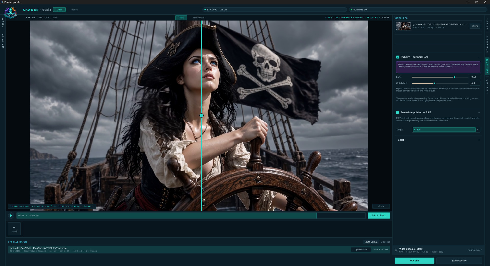
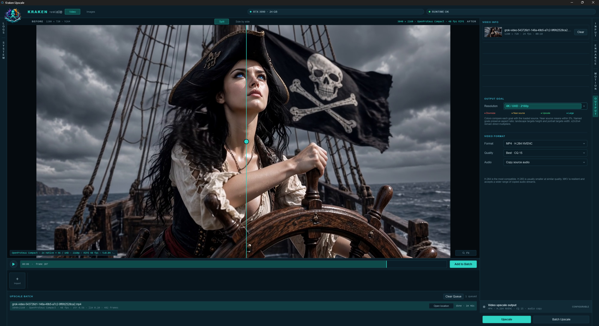
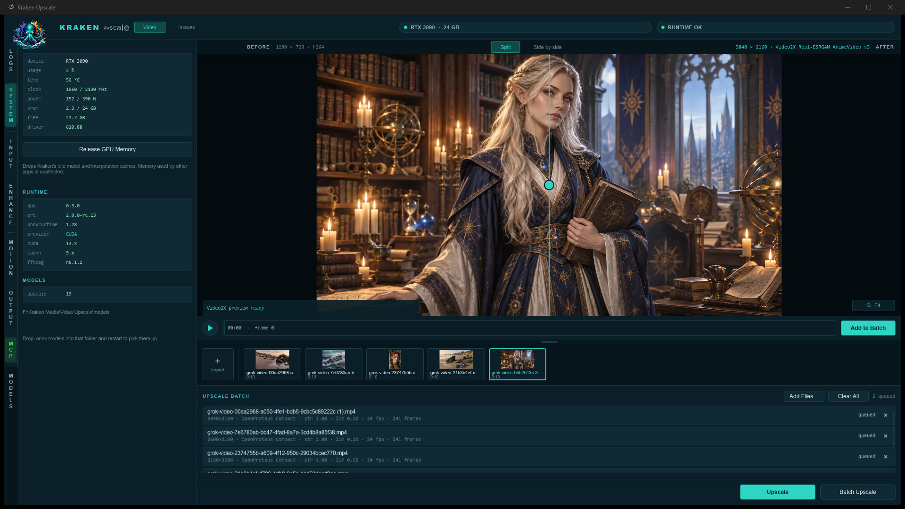

# Kraken Upscale

Native Windows AI upscaler for video and still images. Rust + Slint UI, ONNX
Runtime on NVIDIA CUDA, optional RTX Video Super Resolution, RIFE frame
interpolation, and optional FLUX generative refine.

[Watch the demo on YouTube](https://youtu.be/nv3yAlPCmAo)







## What it does

- Video and still-image modes in one app
- Named output goals (720p through 4K) or ×2 / ×3 / ×4
- Fast single-frame video models plus true multi-frame models (NanoVSR)
- RIFE interpolation to 48 / 60 / 120 fps
- Temporal lock to reduce shimmer on single-frame models
- NVENC H.264 / H.265 to MP4 or MKV, with optional audio copy
- PNG / JPEG / WebP still export
- Optional NVIDIA RTX VSR for fast faithful image and video upscales
- Optional Generative Refine (FLUX img2img) after a faithful pass

Output is written **next to the source file**.

## Requirements

- Windows 10/11, 64-bit
- NVIDIA GPU with a current Game Ready or Studio driver
- [Rust](https://rustup.rs/) 1.92+ (MSVC toolchain) to build from source
- [FFmpeg](https://ffmpeg.org/download.html) (`ffmpeg` and `ffprobe`) on `PATH`,
  or in an `ffmpeg\` folder beside the executable
- CUDA-capable [ONNX Runtime](https://onnxruntime.ai/) (the `ort` crate pulls
  it; extra CUDA provider DLLs can sit next to the exe)

## Build

```bat
cargo build --release
```

Run `target\release\kraken-upscale.exe`. A portable copy can be named
`Kraken Upscale.exe` beside `ffmpeg\`, `models\`, and (if you use them)
`cuda\`, `rtx-vsr\`, and `native-diffusion\`.

## Models

Kraken does not ship weights. Drop ordinary `.onnx` or RRDBNet `.pth` files
into the folders below (next to the exe, or in this repo while developing).
The app scans those folders on startup.

| Folder | What goes here |
|---|---|
| `models/` | Still-image ESRGAN-family models (`.onnx` or `.pth`) |
| `models/video-frame/` | Fast single-frame video / animation models |
| `models/video/` | Multi-frame video models (NanoVSR) |
| `models/interpolation/` | RIFE timestep graph |
| `models/generative/` | FLUX package JSON + weight files |

Optional `models.json` files add nicer names and scale metadata. If a file is
missing from JSON, Kraken still discovers it from the filename.

### Video-frame models (recommended first)

Download the ONNX files and put them in `models/video-frame/`:

| Model | Scale | Best for | Download |
|---|---|---|---|
| Real-ESRGAN General x4v3 | 4× | General / AI video | [Hugging Face](https://huggingface.co/CoderViking/realesr-general-x4v3-onnx) · [Real-ESRGAN](https://github.com/xinntao/Real-ESRGAN/releases) |
| Real-ESRGAN AnimeVideo v3 | 4× | Animation | [vs-mlrt release](https://github.com/AmusementClub/vs-mlrt/releases/tag/model-20211209) · [docs](https://github.com/xinntao/Real-ESRGAN/blob/master/docs/anime_video_model.md) |
| Real-CUGAN Pro Conservative | 2× | 2D, light cleanup | [vs-mlrt](https://github.com/AmusementClub/vs-mlrt/releases/tag/model-20211209) · [Real-CUGAN](https://github.com/bilibili/ailab/tree/main/Real-CUGAN) |
| Real-CUGAN Pro Denoise 3 | 2× | 2D, stronger denoise | same vs-mlrt release |
| AniSD General SPAN | 2× | SD animation | [Sirosky AniSD](https://github.com/Sirosky/Upscale-Hub/releases/tag/AniSD) (`2x_AniSD_G6i1_SPAN_215K_fp32.onnx`) |
| AniSD Cel SPAN | 2× | Cel / flat color | same AniSD release (`2x_AniSD_AC_G6i2b_SPAN_190K_fp32.onnx`) |
| OpenProteus Compact | 2× | Live-action HD | [Sirosky OpenProteus](https://github.com/Sirosky/Upscale-Hub/releases/tag/OpenProteus) |
| ModernSpanimation V1 | 2× | Modern 2D / generated animation | [TNTwise](https://github.com/TNTwise/Models/releases/tag/2x_ModernSpanimationV1) |

SHA-256 hashes of the exact files Kraken was tested with are in
[`models/video-frame/SOURCES.md`](models/video-frame/SOURCES.md).

These graphs still run **one frame at a time**. Turn on **Stability** if you
want the temporal lock. True neighboring-frame models go in `models/video/`.

### Multi-frame video

| Model | Scale | Download |
|---|---|---|
| NanoVSR 644k (5-frame) | 4× | [Project](https://github.com/filippawlicki/nanovsr) · [v1.0 release](https://github.com/filippawlicki/nanovsr/releases/tag/v1.0) |

Place `NanoVSR-644k-T5.onnx` and `NanoVSR-644k-T5.onnx.data` in `models/video/`.
See [`models/video/README.md`](models/video/README.md).

### Interpolation (RIFE)

| File | Download |
|---|---|
| `RIFE_fp32_timestep.onnx` | [Hugging Face — walterlow/RIFE_fp32_timestep](https://huggingface.co/walterlow/RIFE_fp32_timestep) |

Put it in `models/interpolation/`. License: MIT (Practical-RIFE / ECCV2022-RIFE).

### Still-image models

Place these in `models/`. Kraken loads `.onnx` directly, or community
RRDBNet `.pth` files (RealESRGAN, UltraSharp, Remacri, NMKD, …).

| Model | Typical source |
|---|---|
| RealESRGAN 2× / 4× | [xinntao/Real-ESRGAN](https://github.com/xinntao/Real-ESRGAN/releases) |
| 4x-UltraSharp | [Kim2091/UltraSharp](https://huggingface.co/Kim2091/UltraSharp) · [OpenModelDB](https://openmodeldb.info/) |
| 4x-AnimeSharp | [OpenModelDB](https://openmodeldb.info/) |
| 4x_foolhardy_Remacri | [OpenModelDB](https://openmodeldb.info/) |
| NMKD Siax / Faces / Superscale | [OpenModelDB](https://openmodeldb.info/) · author releases |

[OpenModelDB](https://openmodeldb.info/) is the easiest catalog for extra
ESRGAN-family weights. Prefer ONNX when available; otherwise drop the `.pth`
in `models/` and Kraken will import RRDBNet checkpoints.

Each model keeps its own license. Read the page you download from (some are
non-commercial).

### Generative Refine (optional)

FLUX.1 Dev img2img after a faithful upscale. You need:

1. The Windows CUDA build of [stable-diffusion.cpp](https://github.com/leejet/stable-diffusion.cpp/releases/tag/master-813-bfbef5b) in `native-diffusion/`
2. A package under `models/generative/` — see [`models/generative/README.md`](models/generative/README.md)

Q6 GGUF transformer: [city96/FLUX.1-dev-gguf](https://huggingface.co/city96/FLUX.1-dev-gguf)
(`flux1-dev-Q6_K.gguf`). Also required: VAE, CLIP-L, and T5-XXL. FLUX.1 Dev
is a **non-commercial** license.

### RTX VSR (optional)

Images mode can call NVIDIA Video Super Resolution if you place the Video
Effects runtime in `rtx-vsr/` beside the exe. Layout and driver notes:
[`RTX-VSR.md`](RTX-VSR.md).

## License

Kraken Upscale source is MIT — see [`LICENSE`](LICENSE).

FFmpeg is LGPL (`vendor/ffmpeg/LICENSE.txt`). Models, CUDA, cuDNN, ONNX
Runtime, NVIDIA Video Effects, and FLUX weights are covered by their own
licenses.
